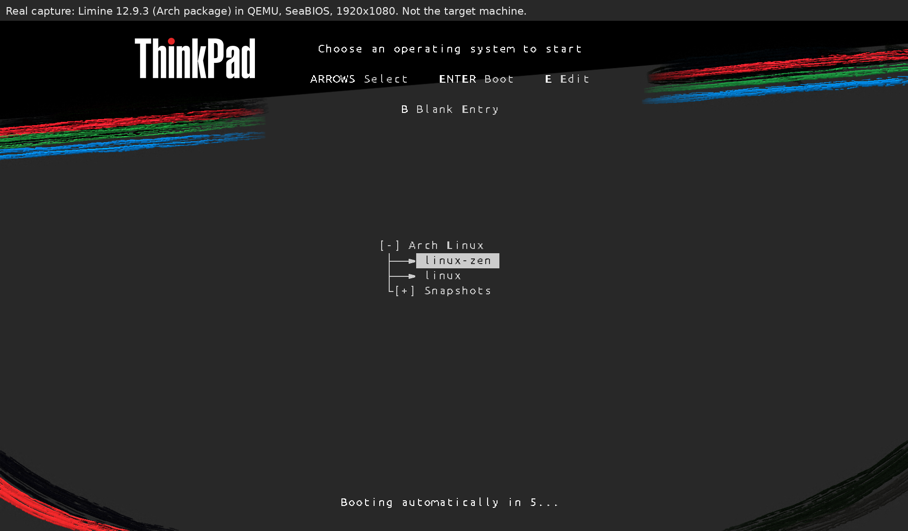
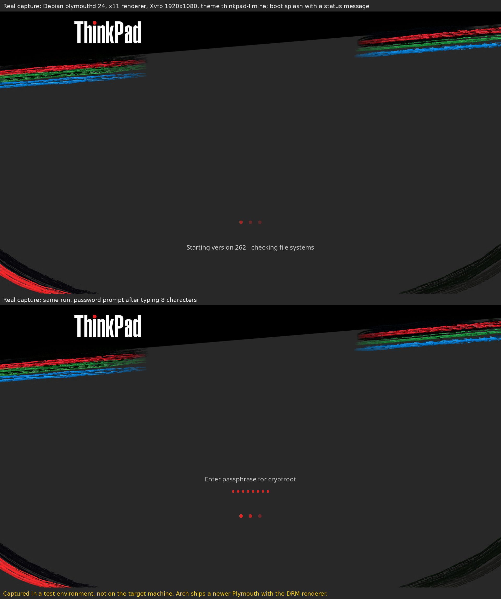

# thinkpad-boot-themes

The ThinkPad look of the distro-grub-themes GRUB theme, rebuilt for the Limine boot menu, with a matching Plymouth splash.

| Limine 12.9.3, booted in a virtual machine | Plymouth, captured with Debian's plymouthd and the x11 renderer |
| --- | --- |
|  |  |

Neither preview was taken on real hardware.

## Limine

For Limine 12.x with its config at `/boot/limine.conf`.

```sh
sudo bash limine/apply-limine-theme.sh
```

The script copies the wallpaper and the menu font into `/boot/limine/` and backs up the config before changing it. Theme settings that are already in the config are replaced in place; only missing ones are added, right after `default_entry:`. Your boot entries stay untouched, and it's safe to run again. If `limine-snapper-sync` is installed, the script runs it too.

If `/boot/limine/limine.conf` exists, Limine reads that file first, so the theme won't show until you move it aside. The script warns you when it finds one. To move it aside:

```sh
sudo mv /boot/limine/limine.conf /boot/limine/limine.conf.old
```

Undo (the script prints the backup name; `ls /boot/limine.conf.bak-theme-*` lists them, and the oldest one is from before the first run):

```sh
sudo cp -a /boot/limine.conf.bak-theme-<timestamp> /boot/limine.conf && sudo rm /boot/limine/thinkpad-wallpaper.png /boot/limine/thinkpad-font.bin
```

## Plymouth

A script-module theme called `thinkpad-limine`.

```sh
sudo bash plymouth/install-plymouth-theme.sh
```

The installer assumes mkinitcpio. It backs up `/etc/plymouth/plymouthd.conf`, replaces `/usr/share/plymouth/themes/thinkpad-limine`, sets the theme as default, and runs `mkinitcpio -P`. The splash only shows if the `plymouth` hook is in `HOOKS` in `/etc/mkinitcpio.conf` and `splash` is on the kernel command line (the `cmdline:` lines in `limine.conf`).

Undo (`<previous-theme>` is the `Theme=` line in the backup the installer printed, `grep Theme= /etc/plymouth/plymouthd.conf.bak-*`; with no backup, it's the `Theme=` in `/usr/share/plymouth/plymouthd.defaults`):

```sh
sudo plymouth-set-default-theme <previous-theme> && sudo mkinitcpio -P && sudo rm -r /usr/share/plymouth/themes/thinkpad-limine
```

## License

GPL-3.0. The art, including the ThinkPad wordmark, is the background of the `thinkpad` theme in [distro-grub-themes](https://github.com/ahmedmoselhi/distro-grub-themes) v3.4 (GPL-3.0), with its GRUB text removed and a painted stripe layer added by `art/make-art.py`. ThinkPad is a trademark of Lenovo. The Limine menu font is a bitmap rendering of Ubuntu Regular, under the Ubuntu Font Licence 1.0 in `limine/FONT-LICENSE`.
